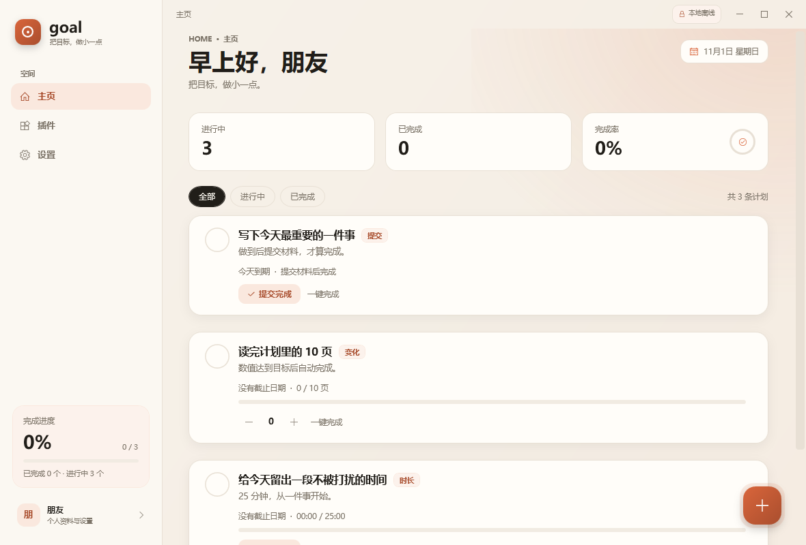
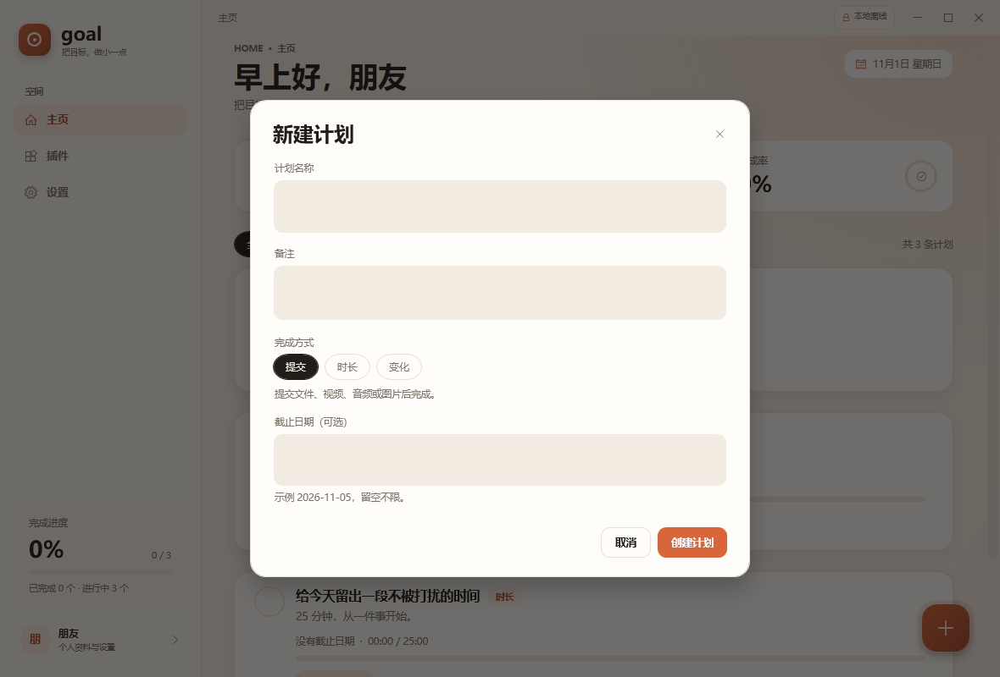
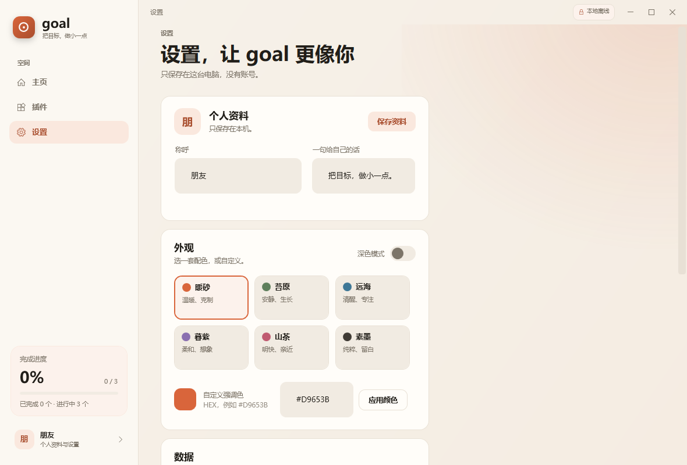
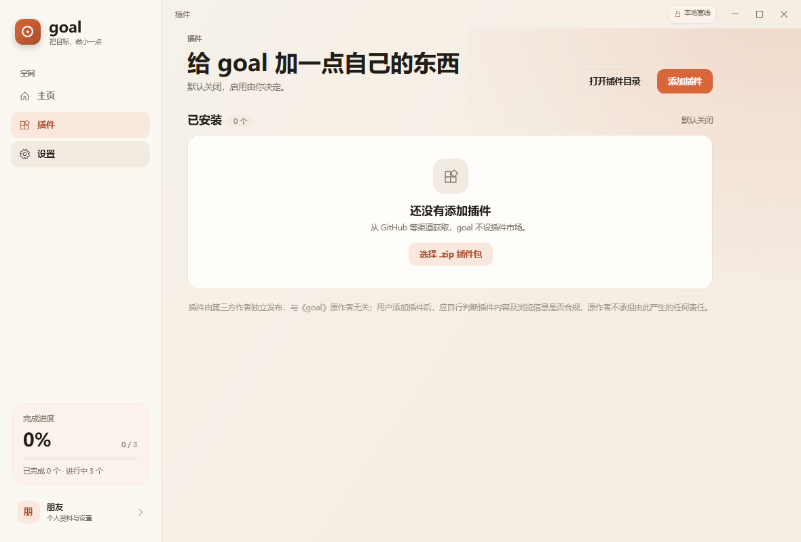

# goal

> 把目标，做小一点。

**goal** 是一款免费、离线、可扩展的任务计划软件。电脑端使用 .NET 10 + WPF，手机端使用原生 Android（Java），两端共用同一份可读 JSON 备份格式。没有账号、广告、云同步和遥测。

---

## 1. 交付物

| 交付物 | 位置 | 说明 |
| --- | --- | --- |
| Windows 安装版（推荐） | `artifacts/goal-1.0.0-setup.exe` | Inno Setup 安装包；当前用户安装，创建开始菜单快捷方式，支持标准卸载；Windows 10 / 11 x64 |
| Windows 免安装版（可选） | `artifacts/goal.exe` | 单文件、自包含，双击即用，不写注册表 |
| Android 版 | `artifacts/goal-1.0.0.apk` | release 签名包；最低 Android 8.0（API 26），目标 API 34 |
| 说明文档 | `docs/README.md` + 根目录 `README.md` | 本文件为完整文档；根目录 README 为 GitHub 展示页 |
| 示例插件 | `examples/plugins/focus-checklist.zip` | 声明式面板插件，可直接安装体验 |
| 更新清单 | `update.json`（根目录） | 两端检查更新时读取的清单；`update/update.json` 为同内容副本 |

产物校验值（SHA-256）见本文末尾“产物校验”。

---

## 2. 设计原则

- **免费**：没有付费墙、广告、账号系统、云同步与遥测。
- **离线优先**：除“检查更新 / 下载更新”和用户主动点击的插件链接外，不发起任何网络请求。
- **数据属于用户**：所有内容保存在本机，可导出为单个可读 JSON，也可从 JSON 导入。
- **克制**：默认只有三条示例计划；界面安静，动画短而轻。
- **可扩展但可解释**：插件是声明式的 JSON 面板，不执行插件代码，安装后默认关闭。

固定责任声明（软件内始终展示）：

> 插件由第三方作者独立发布，与《goal》原作者无关；用户添加插件后，应自行判断插件内容及浏览信息是否合规，原作者不承担由此产生的任何责任。

---

## 3. 功能一览

### 3.1 三种完成方式 + 一键完成

| 名称 | 行为 |
| --- | --- |
| **提交** | 先添加文件、视频、音频或图片等材料，再点击“提交完成” |
| **时长** | 达到设定时长后自动完成；开始/暂停计时，进度按秒累计 |
| **变化** | 数值达到目标后自动完成；用 − / + 调整当前值 |
| **一键完成** | 任意类型都可直接标记完成，不经过上述判定 |

完成方式名称在两端、所有界面中固定为“提交”“时长”“变化”。

提交型计划必须至少有一份本地材料才能完成；材料只在本机复制保存，不会上传，也不会上传到插件或更新服务器。需要跳过材料时，可使用明确的“一键完成”。

### 3.2 界面结构

- 电脑端：左侧栏，栏目为“主页 / 插件 / 设置”；添加计划按钮在内容区右下角浮动显示，任务卡的编辑 / 删除在一键完成菜单中通过右键打开。
- 手机端：底部栏，栏目为“主页 / 插件 / 设置”；添加计划按钮在右下角。
- 主页：进行中 / 已完成 / 完成率三张统计卡，全部 / 进行中 / 已完成筛选，任务卡列表。
- 主题：暖砂、苔原、远海、暮紫、山茶、素墨六套预设；支持深色模式与自定义 HEX 强调色。

### 3.3 数据

- 电脑端数据文件：`%APPDATA%\goal\data.json`
- 手机端数据文件：应用私有目录 `files/goal-data.json`
- 导出：单个 JSON，包含用户信息、配置、任务。
- 导入：先校验格式；通过后让用户选择“覆盖”或“合并”。
  - 覆盖：用户信息、配置、任务全部替换。
  - 合并：保留当前用户与配置，只追加本地不存在的任务（按任务 id）。
- 插件文件不随数据导出；导入也不改动已安装插件。
- 提交材料保存在应用私有目录：电脑端 `%APPDATA%\goal\proofs\<任务 id>`，手机端 `files/proofs/<任务 id>`。
- 备份 JSON 只记录材料元数据，不内嵌二进制文件；换设备导入后，原材料文件不会随 JSON 一起迁移。

### 3.4 插件

- 从本地选择 `.zip` 插件包安装，不内置插件市场，不自动联网下载插件。
- 安装前展示说明、网络权限与固定责任声明，必须勾选确认。
- 安装后**默认关闭**；启用时再次展示责任声明与网络权限。
- 插件面板只支持声明式内容：标题、文本、引用、分隔线、清单、链接、添加计划。
- 插件代码永远不会被加载或执行。
- 链接只能打开 `http(s)`，且域名必须出现在插件清单的 `network` 中。

### 3.5 更新

- 默认加速前缀：`https://ghproxy.net/`，可在设置中修改或恢复默认。
- 检查与下载都走“前缀 + 目标地址”的拼接方式，仅此一处联网（插件外链除外）。
- 清单地址固定为：
  `https://raw.githubusercontent.com/heit-233/goal/main/update.json`
- 发布自己的版本时，请把仓库地址、清单和下载地址替换为实际地址。

---

## 4. 项目结构

```text
goal/
├─ README.md                      # GitHub 展示页 / 发布说明
├─ update.json                    # 更新清单（根目录为实际读取地址）
├─ artifacts/                     # 最终交付产物（构建后生成）
│  ├─ goal-1.0.0-setup.exe
│  ├─ goal-1.0.0.apk
│  ├─ goal.exe                    # 免安装单文件版（可选）
│  └─ SHA256SUMS.txt
├─ installer/
│  ├─ goal.iss                    # Inno Setup 安装脚本
│  └─ ChineseSimplified.isl       # 安装向导简体中文
├─ publish/win-x64/goal.exe       # 安装包输入（构建产物）
├─ docs/
│  ├─ README.md                   # 本文档
│  └─ screenshots/                # 运行截图
├─ examples/plugins/
│  ├─ focus-checklist/            # 示例插件源文件
│  │  ├─ manifest.json
│  │  ├─ panel.json
│  │  └─ README.md
│  └─ focus-checklist.zip         # 可直接安装的示例插件包
├─ update/
│  └─ update.json                 # 更新清单副本
├─ windows/Goal/                  # 电脑端（.NET 10 WPF）
│  ├─ App.xaml / App.xaml.cs
│  ├─ MainWindow.xaml / .xaml.cs  # 壳层、导航、遮罩、Toast
│  ├─ Assets/goal.ico
│  ├─ Controls/
│  │  └─ TaskCard.xaml / .xaml.cs # 任务卡（三种完成方式）
│  ├─ Converters/Converters.cs
│  ├─ Models/
│  │  ├─ AppData.cs               # 用户、配置、任务、备份文档
│  │  └─ PluginModels.cs          # 插件清单、面板、已安装插件
│  ├─ Services/
│  │  ├─ ProofService.cs          # 提交材料复制、删除、打开目录
│  │  ├─ GoalStore.cs             # 任务状态、计时、完成、导入
│  │  ├─ StorageService.cs        # 读写、校验、导出、导入、种子数据
│  │  ├─ ThemeService.cs          # 六套主题与颜色计算
│  │  ├─ PluginService.cs         # 插件包校验、安装、面板读取、外链
│  │  ├─ UpdateService.cs         # 更新检查与下载
│  │  ├─ SingleInstance.cs        # 单实例锁与已有窗口激活
│  │  └─ WindowPlacementService.cs # 窗口位置/大小记忆
│  ├─ Themes/Styles.xaml          # 字体、颜色、控件模板
│  ├─ Views/
│  │  ├─ HomeView.xaml / .xaml.cs
│  │  ├─ PluginsView.xaml / .xaml.cs
│  │  ├─ SettingsView.xaml / .xaml.cs
│  │  ├─ TaskEditorDialog.xaml / .xaml.cs
│  │  ├─ ConfirmDialog.xaml / .xaml.cs
│  │  ├─ ImportChoiceDialog.xaml / .xaml.cs
│  │  ├─ PluginInstallDialog.xaml / .xaml.cs
│  │  ├─ PluginRunnerDialog.xaml / .xaml.cs
│  │  └─ UpdateDialog.xaml / .xaml.cs
│  ├─ GlobalUsings.cs
│  └─ Goal.csproj
├─ android/                       # 手机端（原生 Java）
│  ├─ build.gradle
│  ├─ settings.gradle
│  ├─ gradle.properties
│  ├─ local.properties
│  ├─ keystore/goal-release.jks   # 本地签名文件，不随源码公开
│  └─ app/
│     ├─ build.gradle
│     └─ src/main/
│        ├─ AndroidManifest.xml
│        ├─ java/com/goal/app/
│        │  ├─ MainActivity.java       # 底栏、页面切换、SAF、材料选择、安装 APK
│        │  ├─ ProofStore.java         # 提交材料复制与删除
│        │  ├─ ProofProvider.java      # 材料只读 ContentProvider（系统应用打开）
│        │  ├─ NotificationCenter.java # 到期提醒、通知频道、每日调度
│        │  ├─ ReminderReceiver.java   # 每日提醒广播
│        │  ├─ BootReceiver.java       # 开机恢复提醒
│        │  ├─ HomePage.java           # 主页与统计
│        │  ├─ PluginsPage.java        # 插件页
│        │  ├─ SettingsPage.java       # 设置页
│        │  ├─ TaskCard.java           # 任务卡
│        │  ├─ TaskEditorDialog.java   # 新建/编辑计划
│        │  ├─ ConfirmDialog.java
│        │  ├─ ImportChoiceDialog.java
│        │  ├─ PluginInstallDialog.java
│        │  ├─ PluginPanelDialog.java
│        │  ├─ UpdateDialog.java
│        │  ├─ Store.java              # 状态与持久化
│        │  ├─ Storage.java            # JSON 校验、导入导出
│        │  ├─ PluginManager.java      # 插件包校验与安装
│        │  ├─ UpdateManager.java      # 更新检查与下载
│        │  ├─ Theme.java              # 主题与颜色
│        │  ├─ Models.java             # 与电脑端一致的数据模型
│        │  ├─ Ui.java                 # 程序化 UI 辅助
│        │  ├─ GlyphView.java          # 自绘图标
│        │  ├─ RingView.java           # 环形进度
│        │  ├─ BarView.java            # 条形进度
│        │  ├─ AuraView.java           # 背景光晕
│        │  ├─ BaseCardDialog.java     # 卡片弹窗基类
│        │  ├─ ApkProvider.java        # 安装更新用的 ContentProvider
│        │  ├─ DateTimes.java
│        │  └─ GoalApp.java
│        └─ res/                       # 图标、主题、字符串
└─ test/                          # 构建期辅助测试与截图（不参与发布）
```

---

## 5. 技术方案

### 5.1 电脑端

- **框架**：.NET 10 / WPF，`net10.0-windows`，无第三方运行时依赖。
- **窗口**：无边框 `WindowChrome`，自绘标题栏、238px 左侧栏、内容区、遮罩与 Toast；关闭时把大小、位置、最大化状态写入 `window.json`，下次启动恢复。
- **单实例**：启动时获取命名互斥量；重复启动不会打开第二个进程，而是激活已有窗口，避免并发写坏 `data.json`。
- **页面**：`MainWindow` 按需创建并缓存主页、插件、设置三页；切换时短淡入 + 8px 上移，避免重排闪烁。
- **状态**：`GoalStore` 是唯一任务状态中心，暴露 `Changed`、`TaskCompleted`、`Notice` 事件；页面只读状态并调用命令式方法。
- **计时**：`MainWindow` 每秒调用 `GoalStore.Tick()`，时长型任务根据 `TimerStartedAt` 计算实时进度；达到目标自动完成并持久化。
- **持久化**：`StorageService` 使用 `System.Text.Json`，写入时先写临时文件再替换，保留 `.bak`；只有时长计时运行中才每 12 秒节流保存，避免空转写盘。保存失败会在界面上提示一次，而不是静默丢失。
- **提交材料**：`ProofService` 将选中的文件复制到 `%APPDATA%\goal\proofs\<任务 id>`，删除计划时一并清理；材料文件本身不写入备份 JSON。
- **主题**：`ThemeService` 生成颜色与画刷，启动和切换时替换应用资源；强调色支持 `#RGB` / `#RRGGBB`。
- **发布**：`PublishSingleFile` + `SelfContained` + `IncludeNativeLibrariesForSelfExtract`，生成一个 `goal.exe`；再用 Inno Setup 打包为 `goal-1.0.0-setup.exe`。

### 5.2 手机端

- **范围**：`minSdk 26`（Android 8.0）、`targetSdk 34`、`versionCode 2`、`versionName 1.0.0`。
- **技术**：原生 Java 17，不使用 AndroidX、Material 或任何第三方库；界面由 Java 程序化构建，减少依赖与包体。
- **自绘控件**：`GlyphView` 绘制底栏与操作图标，`RingView` / `BarView` 绘制进度，`AuraView` 绘制右上角柔光。
- **导航**：单个 `MainActivity` + 三个页面对象，底部栏切换，页面懒加载并缓存；返回键从插件/设置回到主页。
- **系统栏**：状态栏与导航栏跟随主题背景，并按明暗设置图标颜色。
- **存储**：`filesDir/goal-data.json`，写入采用临时文件替换；`allowBackup=false`。
- **导入导出**：使用系统 SAF（`ACTION_CREATE_DOCUMENT` / `ACTION_OPEN_DOCUMENT`），不申请存储权限。
- **提交材料**：系统文件选择器多选后，复制到 `files/proofs/<任务 id>`，源文件不移动、不上传；提交型任务没有材料时拒绝完成。材料列表可点击，通过只读 `ProofProvider` 交给系统相册、视频或文件应用打开。
- **页面状态**：切换过的底栏标签在系统回收 Activity 后通过 `onSaveInstanceState` 恢复，不会总是跳回主页。
- **本地提醒**：每天 9:00 由 `AlarmManager` 触发，列出当天到期或已逾期的未完成计划；Android 13+ 首次启动请求通知权限，可在设置中关闭。
- **APK 安装**：更新下载到 `cacheDir`，通过 `ApkProvider` 暴露给系统安装器；Android 8+ 会先引导授权“安装未知应用”。

### 5.3 两端一致性

- 数据模型字段名、类型、语义一致（`camelCase` JSON），任一端导出的备份可在另一端导入。
- 时长型任务的 `target` / `progress` 统一以**秒**存储；编辑界面以分钟输入。
- 变化型任务的 `target` / `progress` 为计数，`unit` 最长 8 字。
- 导入校验规则一致：`app = goal`、`schemaVersion = 1`、任务数 ≤ 5000、标题 ≤ 80、备注 ≤ 500、时长 ≤ 24 小时、每任务材料 ≤ 20。

---

## 6. 构建与运行

### 6.1 电脑端

环境：

- Windows 10 / 11 x64
- .NET SDK 10（本机验证版本 10.0.101）

构建：

```powershell
cd D:\goal
dotnet build windows/Goal/Goal.csproj -c Release
```

直接运行：

```powershell
.\windows\Goal\bin\Release\net10.0-windows\win-x64\goal.exe
```

发布单文件（作为安装包输入）：

```powershell
dotnet publish windows/Goal/Goal.csproj -c Release -r win-x64 --self-contained true `
  -p:PublishSingleFile=true -p:IncludeNativeLibrariesForSelfExtract=true `
  -p:DebugType=embedded -o D:\goal\publish\win-x64 -v:minimal
```

产物：`publish/win-x64/goal.exe`。

生成安装包（需要 Inno Setup 6）：

```powershell
& "C:\Users\<你>\AppData\Local\Programs\Inno Setup 6\ISCC.exe" installer\goal.iss
```

产物：`artifacts/goal-1.0.0-setup.exe`。安装脚本使用简体中文向导，当前用户安装，默认目录 `%LOCALAPPDATA%\Programs\goal`。

### 6.2 手机端

环境（本机验证组合）：

- JDK 17：`C:\Android\jdk17\jdk-17.0.13+11`
- Gradle 8.9：`C:\Android\gradle\gradle-8.9`
- Android SDK：`C:\Android\sdk`，需 `platforms/android-34` 与 `build-tools/34.0.0`
- Gradle Plugin：AGP 8.7.3（首次构建需联网拉取依赖）

构建 release：

```bash
cd /d/goal/android
JAVA_HOME='C:\Android\jdk17\jdk-17.0.13+11' \
  /c/Android/gradle/gradle-8.9/bin/gradle :app:assembleRelease \
  --no-daemon --console=plain
```

产物：`android/app/build/outputs/apk/release/app-release.apk`，复制为 `artifacts/goal-1.0.0.apk`。

签名：

- 签名配置从 `android/keystore.properties` 读取；该文件、keystore 与密码都不提交仓库，已写入 `.gitignore`。
- 本地 `android/keystore.properties` 示例（不要提交真实密码）：

```properties
storeFile=keystore/goal-release.jks
storePassword=你的密码
keyAlias=goal
keyPassword=你的密码
```

- 没有该文件时 `assembleRelease` 仍可编译，但产物未签名，不能直接分发。
- 正式分发前请更换为自己的密钥并离线备份；泄露 keystore 等于允许他人伪造同包名更新。

安装到设备：

```bash
adb install -r artifacts/goal-1.0.0.apk
```

### 6.3 更新清单发布

1. 仓库根目录的 `update.json` 就是读取地址；修改后同步 `update/update.json` 副本。
2. 在 GitHub Releases 上传 `goal-1.0.0-setup.exe` / `goal-1.0.0.apk` / `SHA256SUMS.txt`。
3. 修改清单中的 `version`、`notes`、`url`；版本号必须大于当前版本才会提示更新。
4. 若仓库不是 `heit-233/goal`，同时替换两端代码中的清单地址和清单内的下载地址。

---

## 7. 插件包格式

### 7.1 包结构

一个 `.zip` 文件，根目录或单层文件夹内包含：

```text
manifest.json      # 必需
README.md          # 必需，说明文件（.md / .txt）
panel.json         # manifest.entry 指向的声明式面板
```

### 7.2 manifest.json

| 字段 | 类型 | 必需 | 约束 |
| --- | --- | --- | --- |
| `id` | string | 是 | 3–64 位，字母/数字/点/下划线/短横线，首字符为字母或数字；全局唯一 |
| `name` | string | 是 | 1–40 字 |
| `version` | string | 是 | 1–24 字，建议语义化版本 |
| `author` | string | 是 | 1–40 字 |
| `entry` | string | 是 | 面板 JSON 文件名，必须以 `.json` 结尾 |
| `description` | string | 是 | 说明文件名，必须以 `.md` 或 `.txt` 结尾 |
| `network` | string[] | 否 | 最多 20 项；每项为域名或 `*.域名`；禁止写完整 URL |
| `homepage` | string | 否 | 项目主页，仅作展示 |

示例见 `examples/plugins/focus-checklist/manifest.json`。

### 7.3 panel.json

```json
{
  "type": "goal-panel",
  "title": "一天的专注节奏",
  "subtitle": "三个小步骤，把注意力放回今天。",
  "accent": "#D9653B",
  "blocks": [
    { "type": "heading", "text": "先做最重要的一件事" },
    { "type": "text", "text": "先决定今天唯一必须完成的事情。" },
    { "type": "quote", "text": "把目标做小一点，小到不会失败。" },
    { "type": "divider" },
    { "type": "checklist", "title": "开始前", "items": ["关掉通知", "准备一杯水"] },
    { "type": "addTask", "title": "25 分钟专注", "taskTitle": "25 分钟专注",
      "label": "添加为时长计划", "taskMode": "duration", "target": 25, "unit": "分钟" },
    { "type": "link", "text": "项目主页", "label": "在浏览器中打开",
      "url": "https://github.com/heit-233/goal" }
  ]
}
```

支持的块：

| type | 字段 | 说明 |
| --- | --- | --- |
| `heading` | `text` | 小节标题 |
| `text` | `text` | 正文 |
| `quote` | `text` | 引用块 |
| `divider` | — | 分隔线 |
| `checklist` | `title`, `items[]` | 只读清单 |
| `link` | `text`, `label`, `url` | 外链，域名必须在 `network` 中 |
| `addTask` | `title`, `taskTitle`, `label`, `taskMode`, `target`, `unit` | 添加一条本地计划 |

`addTask` 规则：

- `taskMode` 为 `submit` / `duration` / `variation`。
- `duration` 的 `target` 单位为**分钟**（1–1440），写入任务时转换为秒。
- `variation` 的 `target` 为 1–100000；`submit` 忽略 `target`。
- 必须在面板中由用户主动点击，才会添加计划。

### 7.4 安全限制

- zip ≤ 15 MB，解压后 ≤ 12 MB，文件数 ≤ 300。
- 拒绝绝对路径、`..` 路径穿越。
- 面板入口 ≤ 300 KB，块数 ≤ 60，文本字段超长会截断。
- 已安装同 id 插件时拒绝覆盖；安装后会再次复核 id / entry / description。
- 安装完成强制 `enabled = false`。
- 插件代码不会被执行；仅解析 JSON 并渲染上述块。

### 7.5 插件目录

- Windows：`%APPDATA%\goal\plugins\`
- Android：应用私有目录 `files/plugins/`
- 安装状态：Windows `%APPDATA%\goal\plugins-state.json`；Android `files/plugins-state.json`

---

## 8. 数据备份格式

`schemaVersion` 当前为 `1`。示例（节选）：

```json
{
  "app": "goal",
  "schemaVersion": 1,
  "appVersion": "1.0.0",
  "exportedAt": "2026-11-01T01:14:01.2008185+08:00",
  "user": { "name": "朋友", "motto": "把目标，做小一点。" },
  "config": {
    "theme": "sand",
    "accent": "#D9653B",
    "dark": false,
    "updatePrefix": "https://ghproxy.net/"
  },
  "tasks": [
    {
      "id": "74f70289b1544d45920659ce0cac369f",
      "title": "给今天留出一段不被打扰的时间",
      "note": "25 分钟，从一件事开始。",
      "mode": "duration",
      "target": 1500,
      "progress": 0,
      "unit": "次",
      "dueDate": "2026-11-05",
      "done": false,
      "completedAt": null,
      "timerStartedAt": null,
      "createdAt": "2026-11-01T01:10:56.4022431+08:00",
      "proofs": [
        {
          "name": "完成截图.png",
          "storedName": "20261101085806738-0ee23c-完成截图.png",
          "kind": "image",
          "size": 96392,
          "addedAt": "2026-11-01T08:58:06.7408695+08:00"
        }
      ]
    }
  ]
}
```

字段说明：

- `mode`：`submit` / `duration` / `variation`。
- `target` / `progress`：时长型单位为秒；变化型为计数；提交型为 0。
- `done`、`completedAt`、`timerStartedAt`：完成与计时状态；未填写时导出会省略空值。
- `proofs`：提交材料元数据；`storedName` 只指向本机材料目录中的文件名，不包含二进制内容。
- 导入时会修剪超长文本、夹紧数值、修正非法枚举与日期，并丢弃不安全的材料路径。

---

## 9. 更新清单格式

`update.json`（根目录）：

```json
{
  "windows": {
    "version": "1.0.0",
    "notes": "更新说明",
    "url": "https://github.com/<owner>/<repo>/releases/download/v1.0.0/goal-1.0.0-setup.exe"
  },
  "android": {
    "version": "1.0.0",
    "notes": "更新说明",
    "url": "https://github.com/<owner>/<repo>/releases/download/v1.0.0/goal-1.0.0.apk"
  }
}
```

也支持扁平结构（顶层直接写 `version` / `notes` / `url`），此时两个平台共用。检查逻辑：

1. 读取 `prefix + https://raw.githubusercontent.com/heit-233/goal/main/update.json`。
2. 选择对应平台对象；解析版本并比较。
3. 有更新时展示说明；下载地址同样经过加速前缀。
4. 下载完成后，电脑端打开所在文件夹；手机端调用系统安装器。

网络失败、清单 404、版本号非法都会在设置页给出中文提示，不会崩溃。

---

## 10. 隐私与离线策略

- 不收集任何统计、设备信息或使用行为。
- 不需要登录，不请求通讯录、位置、存储等权限。
- Android 仅声明以下权限：
  - `INTERNET`：检查更新 / 下载更新；插件外链交给系统浏览器。
  - `REQUEST_INSTALL_PACKAGES`：安装下载好的更新 APK。
  - `POST_NOTIFICATIONS`：Android 13+ 的到期提醒，可在设置中关闭。
  - `RECEIVE_BOOT_COMPLETED`：重启后恢复每日提醒。
- 不请求存储权限；文件选择与导出均走系统 SAF。
- 提醒由本机生成，不经过任何推送服务。
- 所有任务、配置、插件均保存在本机；卸载应用会删除应用私有数据（请先导出备份）。
- 插件是否联网由其外链行为决定；goal 自身不会为插件发起后台请求。

---

## 11. 责任声明

软件在插件页页脚、插件安装弹窗、插件运行面板底部均展示以下原文：

> 插件由第三方作者独立发布，与《goal》原作者无关；用户添加插件后，应自行判断插件内容及浏览信息是否合规，原作者不承担由此产生的任何责任。

插件由第三方作者独立发布。用户应只安装可信来源的插件包，并自行判断插件内容及浏览信息是否合规。

---

## 12. 验收说明

### 12.1 已完成的验证

电脑端：

- `dotnet build` 通过，0 warning / 0 error。
- 启动、无边框窗口、左侧栏导航正常；添加按钮位于内容区右下角。
- 新建计划（标题、备注、三种完成方式、截止日期）可保存并在主页显示。
- 三条种子计划使用短备注；统计卡、筛选、空状态、Toast 正常。
- 六套主题 3×2 排列、深色模式、自定义强调色可切换并持久化。
- 插件页只保留页脚一行固定责任声明与空状态，已移除大块说明卡。
- 一键完成：确认弹窗、完成统计、完成提示 Toast 与列表重排均通过界面自动化验证。
- 提交型任务：无材料时点击“提交完成”会先打开系统文件选择器；选择图片后出现“材料只保存在本机”的确认框，确认后任务完成、卡片显示“材料 · 1 份”，JSON 中写入 proofs 元数据。
- 右键任务卡可打开“编辑计划 / 一键完成 / 删除计划”菜单。
- 示例插件安装、默认关闭、启用确认、面板渲染、添加计划、外链域名拦截均通过服务层测试。
- 数据导出 / 导入 / 合并 / 非法文件拒绝通过服务层往返测试。
- 更新检查失败时返回中文错误，不崩溃（当前清单地址按 `heit-233/goal` 配置，发布后生效）。
- 单文件 `goal.exe` 启动正常；安装包静默安装到自定义目录后，开始菜单快捷方式、卸载项、安装版启动均正常，卸载后 `%APPDATA%\goal` 用户数据保留。
- 重复启动只保留一个进程，第二次启动会激活已有窗口。
- 调整窗口大小/位置后关闭，再次启动可恢复 `window.json` 中记录的几何信息。
- 仅计时运行中才周期保存；保存失败会提示一次，而不是静默丢失。

手机端：

- release 构建成功；`aapt dump badging` 校验包名、版本、minSdk/targetSdk、权限与启动 Activity。
- 新增提交材料、长按菜单、底栏文字居中、通知频道/权限/每日调度、深色主题微调与精简文案。
- 新增 `ProofProvider`：材料列表可交给系统应用打开；新增底栏标签状态恢复。
- APK 使用 release 密钥签名（v2 方案，适用于 Android 8.0+）。
- `lintRelease` 通过：0 error，28 warning（均为布局/可访问性/资源建议项）。
- 已把 `windowLightNavigationBar`、`windowLayoutInDisplayCutoutMode` 拆到 `values-v27` / `values-v28`，避免在 API 26 上使用不存在的主题属性。
- 数据层、主题、插件、更新、页面代码与电脑端字段对齐。
- 本机无法启用 Android 硬件加速（未安装 AEHD/WHPX，且当前会话无管理员权限），模拟器无法完成启动，因此未做真机/模拟器交互验证；详见“已知限制”。

### 12.2 手工验收清单

电脑端：

1. 运行 `goal-1.0.0-setup.exe` 完成安装，从开始菜单启动，确认进入主页且无报错；再启动一次安装版，确认只出现一个窗口。
2. 点击右下角“+”，创建三种完成方式的计划各一条。
3. 对提交型先选择图片/文件再“提交完成”；对时长型点“开始”，等待或调整系统时间观察完成；对变化型点“+”。
4. 右键任务卡，确认“编辑计划 / 一键完成 / 删除计划”菜单可用。
5. 切换六套主题与深色模式，重启应用确认仍然生效。
6. 在设置页导出 JSON，修改一条任务后导入，分别选择“覆盖”和“合并”。
7. 在插件页安装 `examples/plugins/focus-checklist.zip`，确认默认关闭；启用后打开面板，点击“添加为时长计划”。
8. 在设置页修改更新前缀并恢复默认；断网点击“检查更新”，确认有中文错误提示。

手机端：

1. 安装 `goal-1.0.0.apk`，确认底栏为“主页 / 插件 / 设置”、文字与图标居中对齐，右下角有添加按钮。
2. 新建三种完成方式的计划；提交型无材料时不能完成，选择图片/文件后可提交。
3. 点击任务卡上的材料行，确认能用系统相册 / 视频 / 文件应用打开；长按任务卡，确认“编辑计划 / 标记完成 / 删除计划”菜单可用。
4. 切换主题与深色模式，确认状态栏/导航栏配色跟随。
5. 在设置中开启到期提醒并允许通知；创建一条今天到期的计划，确认 9:00 提醒（或调整系统时间验证）。
6. 使用系统文件选择器导出、导入备份。
7. 安装示例插件，确认安装前责任声明与默认关闭；启用后打开面板。
8. 检查更新（需先发布真实清单）。

### 12.3 已知限制

- 更新清单默认按 `heit-233/goal` 配置；Fork 或改名后必须同步替换两端代码和清单内的下载地址。
- Android 运行验证：本机未安装硬件加速驱动，模拟器在软件模式下无法启动（QEMU 不执行 guest）；本次交付完成到“签名 APK + lint 0 error + 静态校验”，建议在真机上按 12.2 完成一次安装与交互验收。
- 插件只支持声明式面板，不支持脚本、原生代码或自定义网络请求。
- 电脑端提供 Windows x64 安装包和单文件免安装版，未提供 ARM64 版本；安装包未做商业代码签名，SmartScreen 可能提示未知发布者。

---

## 13. 截图

电脑端（浅色）：









---

## 14. 产物校验

本次构建产物（完整值以 `artifacts/SHA256SUMS.txt` 和 Release 附件为准）：

| 文件 | SHA-256 |
| --- | --- |
| `goal-1.0.0.apk` | `7eb14c4ad9a3527cb8b62d52770d7b544942013e119250d5d471af17ddb64ee3` |
| `goal.exe`（免安装版） | `9f8366aef61dbf25140acc20b947a3b868e725c89734e3579c8c844f5e604745` |
| `goal-1.0.0-setup.exe` | 见 `SHA256SUMS.txt`。安装包内含本文件，为避免“文档哈希随安装包变化”的自引用，不在文档正文写死。 |

---

## 15. 许可与致谢

goal 以免费方式提供。示例插件、图标与界面均由本项目生成。感谢所有愿意把目标做小一点的人。
